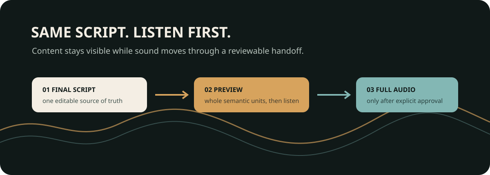
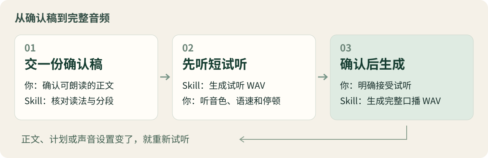

<div align="center">

<h1>中文口播音频 Skill</h1>

<picture>
  <source media="(max-width: 640px)" srcset="docs/hero-mobile.svg">
  
</picture>

**交一份确认好的中文口播稿，先用临时声音看样片，再用自己的音色逐单元生成并确认。**

[价值](#项目解决什么问题) · [交付](#你会得到什么) · [流程](#工作流程) · [安装](#快速开始) · [边界](#验证与限制)

<p><a href="#验证与限制"></a> <a href="SKILL.md"></a> <a href="references/local-setup.md"></a> <a href="requirements.txt"></a></p>

</div>

> [!NOTE]
> 实验阶段。真实合成需要你自己的模型、CUDA 环境和本人或已授权的参考录音。仓库提供 Skill 与配套工具，不包含作者的声音或模型权重。

## 项目解决什么问题

稿子写好了，变成声音时还要处理读法、长句分段和停顿。直接生成整段音频，往往要听到最后才发现音色或语速不合适；如果过程中又改了一份“配音专用稿”，正文和音频也容易对不上。

`generate-zhang-voiceover` 把这一段工作交给 Skill：**接收同一份可见正文，准备稳定单元 ID 和朗读计划，先生成 edge-tts 样片；画面方向锁定后，再用本人音色生成三个候选、词级检查、逐单元确认和完整交付。**

面向制作中文短视频、知识讲解和产品介绍的创作者。日常使用只有两个入口：**写口播稿 → 生成音频**。这个仓库负责第二段，自带计划工具，可以独立接收你已经写好的稿件，无需另外安装母稿转换 Skill。

## 你会得到什么

| 交付 | 用来做什么 |
| --- | --- |
| **短试听 WAV** | 先听音色、语速、专有名词和停顿，再决定是否继续 |
| **逐单元 WAV** | 用稳定 `unit_id` 替换画面，不改稿时复用已确认单元 |
| **`timeline.json` + SRT** | 给字幕、动画和音效避让使用，包含单元、短语、说话区间和可放音效区间 |
| **朗读计划与生成记录** | 记录内容哈希、三个候选的词级检查、选中结果和逐单元确认 |

你负责交稿、听试听；代理负责内部计划和记录。普通使用不需要手动管理 JSON，也不需要维护两份近义稿。

## 工作流程

<picture>
  <source media="(max-width: 640px)" srcset="docs/workflow-mobile.svg">
  
</picture>

| 你来决定 | Skill 来处理 |
| --- | --- |
| 确认可朗读的正文 | 核对读法、语义边界、固定搭配与停顿，审核朗读计划 |
| 判断试听是否合适 | 按完整语义单元生成短试听，提供可播放的 WAV |
| 明确接受样片或逐单元声音，或提出修改 | 只重做文字哈希变化的单元；检查前后衔接后组装完整 WAV |

**改词就改回可见正文。** 自然口语化主要在写稿时完成；需要调整公式或数字的实际读法，也在正文中体现。合成阶段不另藏一份改写稿，计划模式禁用模型侧文本改写和变速。

样片按语速估算约 **15–35 秒**，保留完整单元，实际时长可能不同。样片和正式音频保留相同 `unit_id`，但必须重新测量正式音频的真实时间，不能假定两者时长相同。

## 快速开始

### 1. 安装 Skill

在 Codex 中发送：

```text
使用 $skill-installer 安装下面仓库根目录中的 Skill，
技能目录命名为 generate-zhang-voiceover：
https://github.com/ZhangShixing0/generate-zhang-voiceover
```

安装后，在下一轮对话中调用 `generate-zhang-voiceover`。

<details>
<summary><strong>手动安装，或更新已有安装</strong></summary>

在你的 Codex 用户技能目录下克隆仓库：

```text
git clone https://github.com/ZhangShixing0/generate-zhang-voiceover.git
```

保留完整文件夹，尤其是根目录的 `SKILL.md`、`scripts/`、`references/` 和 `agents/`。已有同名安装时，先比较并保留自己的声音配置、参考录音和缓存，不要覆盖私人文件。

</details>

### 2. 配置自己的声音

按[本地声音配置](references/local-setup.md)准备 VoxCPM2、匹配的 CUDA / PyTorch 环境，以及本人或已获授权的参考录音，再填写[声音配置模板](references/voice-profile.example.json)。

示例配置不会直接提供可用的声音。已有个人安装可继续使用自己的 `voice-profile.json`；也支持通过 `--profile` 或 `ZHANG_VOICE_PROFILE` 指向外部配置。

### 3. 交稿，先听一小段

准备一份已确认的口播 TXT，在 Codex 中发送：

```text
使用 $generate-zhang-voiceover，
按这份已确认的口播稿和我的本地声音配置生成试听。
先让我听音色、语速和停顿，我明确确认后再生成完整音频。
```

第一次建议运行 `--stage draft` 得到免费临时配音和同编号的画面时间表。edge-tts 会把脚本文字发送到在线服务，不上传你的参考录音；正式 VoxCPM 音频仍在本地生成。完整调用约定和命令见 [SKILL.md](SKILL.md)。

<details>
<summary><strong>还没有模型？先用示例检查朗读计划</strong></summary>

在仓库目录运行以下命令，无需 GPU、语音模型或真人录音：

```text
python -m pip install -r requirements-dev.txt
python scripts/voiceover_plan.py build --text-file examples/voiceover.txt --output outputs/demo-plan.json
python scripts/voiceover_plan.py validate --text-file examples/voiceover.txt --plan outputs/demo-plan.json
python -m unittest discover -s scripts -p "test_*.py"
```

仓库的[合成示例稿](examples/voiceover.txt)包含三段正文。你会得到保留原文的朗读计划，并看到校验结果；这一步不会生成音频。生成的计划仍需代理实际检查后再执行 `approve`，计划审核也不代表用户已经接受声音。

依赖见 [requirements.txt](requirements.txt) 和 [requirements-dev.txt](requirements-dev.txt)。

</details>

## 验证与限制

当前版本通过 **38 项本地测试**，覆盖词级语速、相邻短语跳变、无标点停顿、候选路径、稳定 ID、缓存损坏、时间表/SRT、音效避让区间和整段录音切分。测试不需要 GPU 或真人录音。

**这些检查不证明实际音色自然。** 本次发布未新生成真人声音，也未完成跨平台 GPU 合成验证；最终听感仍要由实际试听判断。

| 当前范围 | 需要知道的边界 |
| --- | --- |
| **VoxCPM2 本地合成** | 沿用 CUDA 路线与提示缓存接口；CPU 合成及其他引擎未作为支持路径，升级引擎后需重新测试 |
| **三个候选自动选择** | 每个单元按语速、逐字识别、停顿、响度和音高衔接打分；三个都失败时停止交付并保留诊断 |
| **单一参考音色** | 计划中的“意图”是检查提示，适配器不据此自动控制情绪或逐句切换音色 |
| **Vosk 对齐** | 提供词级时间和置信度，不伪造单字时间；缺少对齐证据的正式候选不会自动通过 |
| **语速控制** | 已删除 `--speed` 和所有变速处理；只能重新生成并挑选候选 |
| **edge-tts 样片** | 需要网络；它只是临时画面样片，不能作为本人音色确认 |

仓库附有 [GitHub Actions 配置示例](examples/github-actions-tests.yml)，**线上自动测试尚未启用**。具备工作流管理权限后，可将示例放入 `.github/workflows/tests.yml`；本地通过不代表所有矩阵环境都已通过。

## 安全与隐私

只使用本人或已获授权的参考声音。模型、参考音频、提示缓存、个人配置、朗读计划、生成记录和正式 WAV 均留在本地。公开包不含作者录音、真实项目稿件或生成音频。样片阶段会把脚本文字发送给 edge-tts 在线服务，使用前应确认这符合你的隐私要求。

`.gitignore` 已覆盖这些本地产物，分享或再次发布前仍应核对实际文件。参考音频与缓存的校验方法见[本地配置说明](references/local-setup.md)。

## 边界与许可

本 Skill 负责从确认稿到音频的交接与生成，不制作视频。语音引擎来自 [OpenBMB/VoxCPM](https://github.com/OpenBMB/VoxCPM)，本项目提供朗读计划、按稿执行和试听确认流程。

**作者尚未指定本项目的开源许可证，保留相应权利。** 仓库公开不等于授予开源许可；第三方引擎与模型遵循各自许可。
